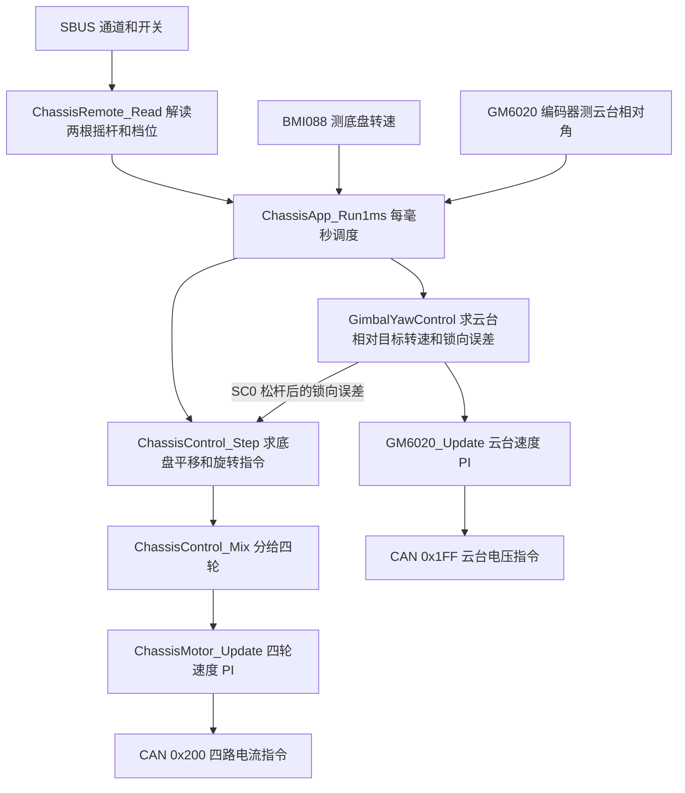

# RoboMaster 麦轮底盘 · 从摇杆读到电机

这套固件运行在 STM32F407IGH6 底盘板上，控制四个麦克纳姆轮和一台可以连续转动的 GM6020。GM6020 负责云台左右转动（yaw），云台上下俯仰（pitch）由另一块云台板负责。

第一次打开工程，先找到 `ChassisApp_Run1ms()`。把它当成每毫秒执行一次的目录，顺着读完「遥控输入 → 云台目标 → 底盘运动 → 四轮目标 → 电机输出」。遇到某个量不清楚，再进入对应函数。[底盘调度源码](Core/Src/chassis_loop.c)

| 阅读顺序 | 在编辑器里搜索 | 带着这个问题读 |
| --- | --- | --- |
| 1 · 找入口 | `main` → `HAL_TIM_Base_Start_IT` → `HAL_TIM_PeriodElapsedCallback` | 哪一行启动定时器？到下一个 1 ms 时，哪个回调接手？[main.c](Core/Src/main.c) |
| 2 · 看一轮输入 | `ChassisApp_Run1ms` → `ChassisRemote_Read` | 跨过左杆死区后，哪个字段代表我想往前走多快？[chassis_loop.c](Core/Src/chassis_loop.c) · [chassis_remote.c](Core/Src/chassis_remote.c) |
| 3 · 看目标与反馈 | `ChassisControl_Step` → `ChassisControl_Mix` → `ChassisMotor_Update` | 车身速度在哪一步拆成四轮目标？哪一步才用上实际轮速？[chassis_motion.c](Core/Src/chassis_motion.c) · [chassis_motor.c](Core/Src/chassis_motor.c) |

## 拿起遥控器，先分清三个方向

**车头**是底盘的正前方。**云台朝向**是 GM6020 当前指向的方向，可以相对车头转动。**对地航向**描述的是从地面看它朝哪里。想象左杆一直推前，右杆把云台向左转了 90°，此时左杆给出的前进方向也向左转了 90°。坐标约定为车头向前是 `+x`，向左是 `+y`，从上往下看逆时针为 yaw 正方向。

| 遥控操作 | SBUS 通道 | 本工程怎样解释 |
| --- | --- | --- |
| 左杆前后、左右 | `channels[2]`、`channels[3]` | 给出沿云台前方、左方的平移分量。每个轴满杆对应 8000 rpm 的轮速分量。 |
| 右杆左右 | `channels[0]` | 控制云台 yaw，左正右负，满杆约 ±50 rpm。回中后锁住当时的对地航向。 |
| SC 三档拨杆 | `channels[4]` | 选择下表中的跟随、低速自旋或高速自旋。 |
| SD 总使能 | `channels[5]` | 原始值大于 1400 时允许输出，还要满足遥控和传感器反馈条件。 |

通道下标从 0 起算。`ScaleStick()` 用 `(1024 − 原始值) / 671` 换算摇杆比例，限制在 −1 到 +1 之间，中位附近约 5% 的小变化归零。[遥控映射](Core/Src/chassis_remote.c)

| 档位 | 右杆转动云台时 | 右杆回中后 |
| --- | --- | --- |
| SC0 下档 · 跟随 | 云台按右杆转动，车头按云台与车头的角差追过去。 | 锁定松杆瞬间的航向。云台稳住该方向，车头也追到该方向，进入约 2° 的死区后旋转指令归零。 |
| SC1 中档 · 低速自旋 | 底盘叠加 1500 rpm 的自旋轮速分量，右杆仍可转云台。 | 底盘继续自旋，云台保持对地朝向。左杆持续推前就沿该朝向给出直线平移指令。 |
| SC2 上档 · 高速自旋 | 自旋轮速分量提高到 3000 rpm，右杆操作同 SC1。 | 云台稳向、左杆平移的规则同 SC1。 |

这里的 1500、3000 都是**用于四轮混控的电机转子转速分量**。车身在地面上实际转多快，程序用 BMI088 测量。`rc_mode` 表示遥控选择的自旋档，`chassis_command.mode` 表示本轮控制实际执行的模式。[模式和参数定义](Core/Inc/chassis_motion.h) · [模式计算](Core/Src/chassis_motion.c)

## 上电以后，谁在什么时候工作

上电时关闭 SD，让底盘静置。`main()` 初始化 GPIO、CAN1、TIM6、USART1 和 SPI1，先拉高 BMI088 两路片选，等待 100 ms，然后读取陀螺仪 ID 和量程。接着启动 CAN、遥控接收和 TIM6。进入主循环后，用最初 200 次成功的角速度读数求静止零偏，正常约需 1 秒。[启动流程与回调](Core/Src/main.c) · [零偏计算](Core/Src/chassis_loop.c)

| 触发方式 | 读取入口 | 这一刻发生什么 |
| --- | --- | --- |
| USART1 每收到一个字节 | `RC_SBUS_ReadByte` | 拼满 25 字节并检查帧头、帧尾，解出 16 路摇杆和开关值，保存丢帧标志与接收时间。 |
| CAN1 收到电机反馈 | `ChassisMotor_ReadCAN` | 按帧 ID 更新对应轮速，或更新 GM6020 的编码器角度和相对转速。 |
| 主循环每 5 ms | `main` 的 `USER CODE BEGIN 3` | 阻塞式 SPI 连读 BMI088 的 Z 轴低、高字节。成功后换算角速度，交给 `ChassisApp_SetGyroZ`。 |
| TIM6 每 1 ms | `ChassisApp_Run1ms` | 复制最新遥控和反馈，计算云台及四轮目标，再发送两组 CAN 指令。两次 IMU 采样之间会复用最近的有效读数。 |

**回调**就是外设事件发生时由 HAL 调用的函数。**快照**是在很短的临界区内把一组数据复制到局部变量，所以同一轮计算用到的通道、角度和时间戳彼此对应。[SBUS 接收与快照](Core/Src/rc_sbus.c) · [电机反馈解析](Core/Src/chassis_motor.c)



## 跟读一轮计算

假设遥控和反馈正常、SD 已使能、SC 在中档。左杆向前半杆，右杆回中。底盘正在自旋，这一瞬间云台正好在车头左侧 90°。从 `ChassisApp_Run1ms()` 往下看，关注四次数据变化。

1. **把摇杆换成目标。** 假设 `rc_vx = 0.5`、`rc_vy = 0`，则 `input.vx_rpm = 4000`、`input.vy_rpm = 0`。这两个分量以云台为参考。右杆回中时 `input.yaw_target_rpm = 0`。[输入换算](Core/Src/chassis_remote.c)
2. **把云台前方换成车身方向。** `ChassisControl_Step()` 从本轮编码器反馈得到相对角。云台正对车身左侧，所以 `chassis_command` 的车身分量约为 `vx_rpm = 0`、`vy_rpm = 4000`。SC1 同时给出 `wz_rpm = 1500`。底盘继续转动时，下一毫秒会按新的相对角重新换算。[坐标变换](Core/Src/chassis_motion.c)
3. **把三个分量合成四轮转速。** `ChassisControl_Mix()` 按左前、右前、右后、左后的顺序，结合每个电机的安装方向，得到约 `[-5500, -5500, 2500, 2500] rpm`。若任一轮超过 8000 rpm，四个目标一起同比缩小，保持各轮之间的比例。[四轮混控](Core/Src/chassis_motion.c)
4. **让电机跟上目标。** 左前轮若反馈 −5300 rpm，速度误差就是 `−5500 − (−5300) = −200 rpm`。速度环的 P 项响应当前误差，I 项累加持续存在的误差。程序限制输出后，把四路结果打包成电流指令发给电调。下一毫秒再根据反馈修正，这就是速度闭环。[四轮 PI 与 CAN 发送](Core/Src/chassis_motor.c)

要手算第 3 步，可以把 `Mix` 中的三个数组并排看。`k_vy` 决定横移分量对该轮取哪个符号，`k_wz` 决定自旋分量的符号，最后乘 `wheel_dir` 换成电机安装方向。这个例子里车身前后分量为零。

| 轮子 | 横移分量 + 自旋分量 | 安装方向 | 电机目标（rpm） |
| --- | --- | --- | --- |
| 左前 `motor[0]` | −4000 − 1500 | +1 | −5500 |
| 右前 `motor[1]` | +4000 + 1500 | −1 | −5500 |
| 右后 `motor[2]` | −4000 + 1500 | −1 | +2500 |
| 左后 `motor[3]` | +4000 − 1500 | +1 | +2500 |

## 为什么底盘在转，云台还能朝着同一个方向

读 `GimbalYawControl()` 时，把**底盘对地转速**和**云台相对底盘转速**写在纸上。BMI088 固定在底盘上，提供前一个量。GM6020 的 CAN 转速反馈提供后一个量。统一正方向后，两者相加就是云台对地转速。[云台控制](Core/Src/chassis_loop.c) · [GM6020 反馈](Core/Src/chassis_motor.c)

```text
底盘实测 yaw rpm = IMU 方向系数 × (Z 轴读数 − 静止零偏) / 6
云台相对目标 rpm = 云台对地目标 rpm − 底盘实测 yaw rpm
```

这里除以 6，是因为一圈 360°、一分钟 60 秒，1 rpm 对应 6°/s。假设底盘对地转速为 +20 rpm，云台已对准锁定方向，对地目标为 0，那么 GM6020 应相对底盘转 −20 rpm。看 Watch 时，右杆回中而 `gm6020_rpm` 有读数，正是这种反转补偿可能产生的结果。

**锁住方向还需要角度。** 电机编码器一圈 8192 个计数，车头和云台对齐时的机械零位设为 4250。代码用编码器求出云台相对角，再把底盘实测角速度按 1 ms 积分得到底盘航向。两角相加得到云台对地航向估计。松杆时保存该方向，之后按最短角差修正。比如从 +179° 到 −179°，跨过边界只差 2°。这个对地参考来自陀螺仪积分，长时间工作会受零偏漂移影响。

**SC0 松杆时，车头和云台各自追同一个目标。** 假设松杆时锁定 40°，稍后车头在 30°、云台在 38°。此时云台相对车头为 8°，云台自身还需修正 2°，所以车头的跟随误差是 `8° + 2° = 10°`。即使云台在修正时轻微回摆，车头仍追 40°。左杆平移则始终按**云台当前实际相对角**换算，所以主动转云台时，前进方向也跟着变。[锁向与底盘跟随](Core/Src/chassis_motion.c)

## 在调试器里看懂数据

用 Debug 构建进入调试后，可以按表从上往下看。`imu_gyro_z_dps` 保留传感器换算值，`gyro_feedback.yaw_rpm` 是扣除零偏并统一方向后供控制使用的值。

| 想弄清什么 | Watch 变量 | 怎样读 |
| --- | --- | --- |
| 遥控帧是否到达 | `rc_cnt`、`rc_ch[0]`、`rc_ch[2]`、`rc_enable`、`rc_lost` | 计数增长表示收到了格式合格的帧。总使能与失联状态要分别看。 |
| BMI088 是否开始采样 | `imu_gyro_id`、`imu_gyro_range`、`imu_gyro_read_status`、`imu_gyro_z_dps` | 正常启动时 ID 为 `0x0F`，量程寄存器为 `0x00`（±2000°/s）。读取状态 `0` 表示最近一次传输成功。 |
| 云台和底盘各在怎样转 | `gm6020_angle_raw`、`gm6020_rpm`、`gyro_feedback.yaw_rpm`、`yaw_preview_rpm` | 依次是编码器计数、电机相对转速、底盘实测转速、右杆给定转速。 |
| 当前在执行哪种动作 | `chassis_command.mode`、`chassis_command.vx_rpm`、`chassis_command.vy_rpm`、`chassis_command.wz_rpm` | 观察实际模式和三个混控分量。只推前时，车身坐标中的 `vx`、`vy` 会随云台相对角变化。 |
| 目标有没有传给电机 | `motor[0].target`、`motor[0].rpm`、`motor[0].cmd` | 左前轮目标转速、实测转速、下发的电流指令值。 |

**有遥控数据却显示 `CHASSIS_ZERO_FORCE` 时**，先看 SD 是否允许、遥控是否失联。启动后尚未收到合格帧、SBUS 标记丢帧或失控、距最近一帧超过 100 ms，都可禁止驱动。正常使用云台的三个档位还要求 IMU 完成校准，最近一次 IMU 读数和 GM6020 相对角反馈都在 20 ms 内。自旋档未启用云台也会禁止驱动。四个车轮的转速反馈按各自最近一次 CAN 数据参与 PI 运算。[使能判断](Core/Src/chassis_loop.c) · [遥控有效性](Core/Src/chassis_remote.c)

## 查硬件、参数和构建入口

| 接口 | 当前工程的配置 |
| --- | --- |
| 主控与调度 | STM32F407IGH6，系统时钟 168 MHz。TIM6 时钟 84 MHz，预分频 8399、周期 9，每 1 ms 触发控制回调。 |
| 遥控接收 | USART1 仅接收，PB7 为 RX，100000 波特，8 个数据位、偶校验、2 个停止位。HAL 的 9 位字长包含校验位。 |
| BMI088 | SPI1 全双工主机，Mode 3，软件片选，328.125 kbit/s。PB3/PB4/PA7 分别是 SCK/MISO/MOSI，PB0 选陀螺仪、PA4 选加速度计。读 Z 轴时连续读取 `0x06` 和 `0x07`，低字节在前。 |
| 电机总线 | CAN1，1 Mbit/s，PD0 为 RX、PD1 为 TX。四轮反馈 `0x201`～`0x204`，四轮电流命令 `0x200`。GM6020 反馈 `0x206`，电压命令在 `0x1FF` 的 `data[2]` 和 `data[3]`。 |

外设引脚与时钟可以在 CubeMX 工程中查看。生成的初始化文件在 `Core/Src/`，应用层的 `chassis_*.c` 集中处理运动和控制。[CubeMX 工程](Chassis.ioc) · [SPI 初始化](Core/Src/spi.c) · [定时器初始化](Core/Src/tim.c)

| 想了解的参数 | 当前值及用途 | 定义位置 |
| --- | --- | --- |
| SC0 跟随快慢 | `CHASSIS_FOLLOW_KP = 3000`、`CHASSIS_FOLLOW_RPM_MAX = 2250`、`CHASSIS_FOLLOW_DEADBAND_RAD = 0.035`。分别控制每弧度角差对应的转向轮速、轮速分量上限和约 2° 的死区。 | [chassis_motion.h](Core/Inc/chassis_motion.h) |
| SC1、SC2 自旋快慢 | `CHASSIS_SPIN_RPM_LOW = 1500`、`CHASSIS_SPIN_RPM_HIGH = 3000`。 | [chassis_motion.h](Core/Inc/chassis_motion.h) |
| 云台摇杆与稳向 | `YAW_PREVIEW_MAX_RPM = 50` 控制右杆满杆给定。`APP_YAW_HOLD_KP = 12`、`APP_YAW_HOLD_MAX_RPM = 15` 控制航向校正项的增益和上限。 | [遥控参数](Core/Src/chassis_remote.c) · [稳向参数](Core/Src/chassis_loop.c) |
| 安装方向与零位 | `APP_IMU_YAW_DIR = 1` 对应俯视逆时针时 IMU 读正。`GM6020_YAW_DIR = 1` 对应电机方向换算。`gm6020_yaw_zero_raw = 4250` 定义机械对齐位置。 | [IMU 方向](Core/Src/chassis_loop.c) · [电机方向](Core/Inc/chassis_motor.h) · [机械零位](Core/Src/chassis_motor.c) |

**构建固件。** 在项目根目录打开能找到 CMake 3.22 或更高版本、Ninja 和 Arm GNU 工具链（`arm-none-eabi-gcc`）的终端，运行以下命令。[构建预设](CMakePresets.json) · [编译器配置](cmake/gcc-arm-none-eabi.cmake)

```powershell
cmake --preset Debug
cmake --build --preset Debug
```

生成的固件是 `build/Debug/Chassis.elf`。本仓库的 VS Code 调试配置使用 ST-Link，`runEntry` 设为 `main`。如果想在电脑上单独阅读运动算法的输入输出示例，可以打开 `tests/chassis_motion_test.c`，从正负 90° 的坐标变换和四轮分配示例看起。[调试配置](.vscode/launch.json) · [运动算法示例](tests/chassis_motion_test.c)
