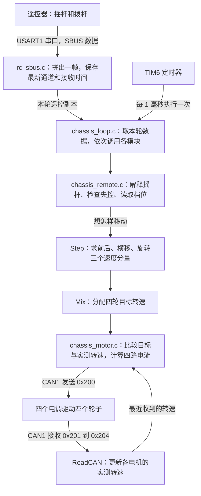
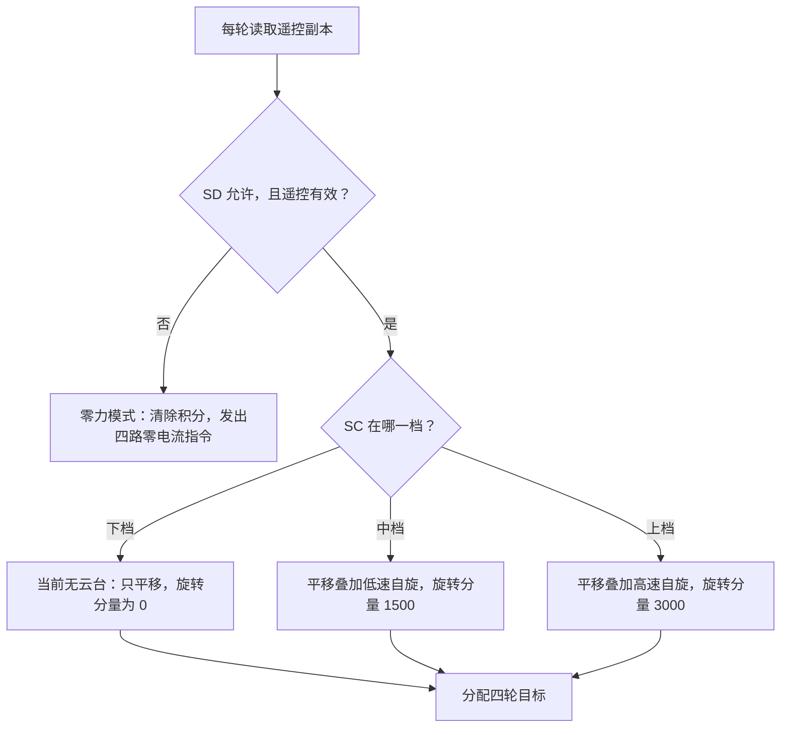

# 麦轮底盘控制程序

这块 STM32 板控制四个麦克纳姆轮。操作者给出“往哪走、要不要自旋”，程序算出四个轮子各自该转多快，再根据电机回报的实际转速调整电流。下面按实车上数据流动的顺序读代码。

## 整台车怎样动起来

看图时可以沿着两条线走。上半段把人的操作变成**目标转速**。下半段把**实测转速**送回计算过程，每轮用两者的差来调整电流，这个循环叫速度闭环。电调是直接给电机供电、执行电流指令的设备。

## 上电以后，谁在什么时候工作

[main.c](Core/Src/main.c) 先配置硬件，启动 CAN1，清空电机状态，点亮停止灯，再启动遥控接收、CAN 接收通知和 TIM6。随后程序进入空的 `while (1)`。硬件事件发生时，芯片会执行对应的回调函数，因此空循环里的车仍然能响应遥控。

| 什么事件发生了 | main 把工作交给谁 | 这一次做什么 |
|---|---|---|
| 串口收到一个字节 | `RC_SBUS_ReadByte` | 接着拼遥控数据。收齐并通过格式检查的 25 字节，才解出 16 路通道，更新接收时刻和失控标志。 |
| CAN1 收到数据 | `ChassisMotor_ReadCAN` | 检查帧头和编号，把对应电机的实测转速存入 `motor[i].rpm`。 |
| TIM6 到了下一个 1 毫秒 | `ChassisApp_Run1ms` | 取最近的数据跑一轮完整的底盘控制。每隔 100 毫秒，还按是否允许输出刷新指示灯。 |

前两项随数据到达而发生。定时器读的是当时最新的一份数据，一帧遥控可以供好几轮控制使用。函数开头的 `RC_SBUS_CopyData(&rc)` 让本轮所有摇杆和拨杆判断使用同一份副本。

## 推一下摇杆，追踪一轮真实计算

假设遥控正常、SD 已允许输出、SC 在下档，只向前推杆。为了便于心算，假设处理后的摇杆比例为 `0.5`。

| 走到哪一步 | 本轮发生什么 | 可以在代码中看哪个值 |
|---|---|---|
| ① 读摇杆 | 前后通道从原始整数换算为 −1 到 +1 的比例。 | `rc.channels[2]` → `rc_vx = 0.5` |
| ② 算整车指令 | 满杆对应 8000，半杆就是 4000。当前无云台、关闭自旋，因此只需要向前。 | `chassis_command` 的 `vx_rpm = 4000`，`vy_rpm = wz_rpm = 0` |
| ③ 分给四轮 | 按左前、右前、右后、左后的顺序，目标是 `[4000, -4000, -4000, 4000]`。左右电机安装方向不同，两侧符号相反时，轮子共同推车向前。 | `wheel_targets[0..3]` |
| ④ 用实测值修正 | 假设左前轮实测 3800，目标 4000，本轮误差就是 200 转/分。比例项 P 响应当前误差，积分项 I 累加持续的误差，两者合起来决定电流指令。 | `motor[0].rpm`、`err`、`cmd` |
| ⑤ 输出并继续 | 把四个电流指令装进一帧 CAN 数据发给电调。下一毫秒再用最新转速计算。 | CAN 帧编号 `0x200` |

这里的 rpm 是电机转子每分钟转数。叠加平移和自旋后，如果某个轮子的目标超过 8000，程序把四轮目标按同一比例缩小，保留轮子之间的速度比例。

## 拨杆和失联怎样影响结果

还没收到有效遥控帧、接收机报告丢帧或失控、距上一帧超过 100 毫秒，都会进入图中的零力分支。SD 使用通道 `[5]`，SC 使用 `[4]`，前后和横移分别使用 `[2]` 和 `[3]`。通道 `[0]` 和 `[1]` 留给云台。

**为什么当前自旋时推前会走弧线？** 当前配置 `CHASSIS_GIMBAL_INSTALLED = 0`，摇杆的“前”指向车头。车头一边转，前进方向也跟着转。代码已经有根据相对角换算平移方向的分支，真实云台反馈入口仍待接入。图中的 1500、3000 都是用于合成轮速的旋转分量，不代表车身每分钟转这么多圈。

## 从哪个文件开始读

| 想弄清的问题 | 打开文件 | 先找这个函数 |
|---|---|---|
| 一轮控制按什么顺序执行？ | [chassis_loop.c](Core/Src/chassis_loop.c) | `ChassisApp_Run1ms`，按顺序找到 CopyData、Remote_Read、Step、Mix、Update |
| 谁启动这一轮？ | [main.c](Core/Src/main.c) | `HAL_TIM_PeriodElapsedCallback` |
| 遥控字节怎样变成通道？ | [rc_sbus.c](Core/Src/rc_sbus.c) | `RC_SBUS_ReadByte` |
| 原始通道怎样变成平移速度和自旋档位？ | [chassis_remote.c](Core/Src/chassis_remote.c) | `ChassisRemote_Read` |
| 想向前走，四轮各转多快？ | [chassis_motion.c](Core/Src/chassis_motion.c) | `ChassisControl_Step` 和 `ChassisControl_Mix` |
| 实际轮速跟不上时怎么办？ | [chassis_motor.c](Core/Src/chassis_motor.c) | `ChassisMotor_Update` |
| 怎么在电脑上验证这些计算？ | [chassis_motion_test.c](tests/chassis_motion_test.c) | 测试程序的 `main` 填入模拟输入，检查模式、方向、超时和轮速结果 |

`Core/Inc/` 的头文件列出函数接口、结构体成员和共用参数。`Core/Src/` 的同名源文件写具体步骤。第一次阅读时，从 `ChassisApp_Run1ms` 跟完上面的半杆示例，就能把几个文件连起来。
